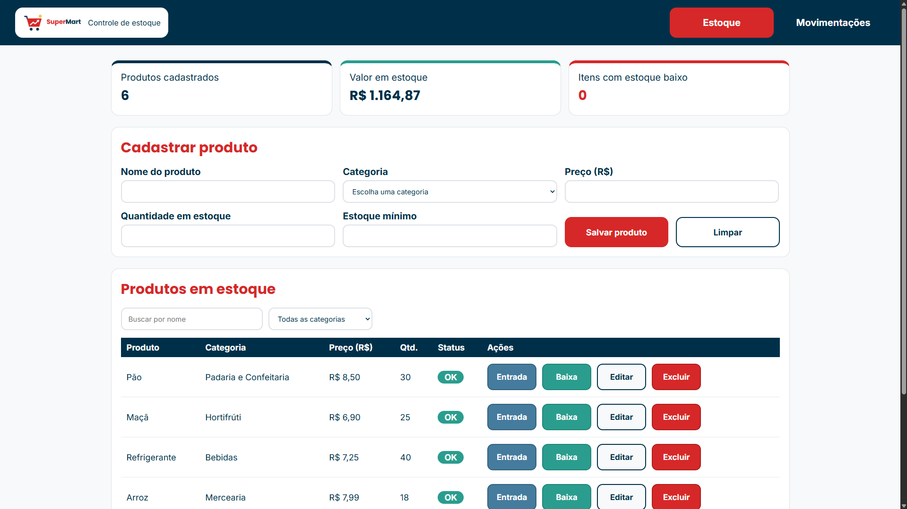
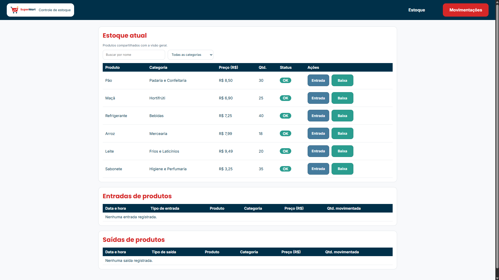

# SuperMart | Controle de estoque

Sistema web de gerenciamento de estoque para o mercado **SuperMart**, feito com **HTML, CSS e JavaScript puro**, sem frameworks nem bibliotecas. Projeto em trio da disciplina de Programação Web Front-End.

Os produtos e o histórico de entradas e saídas ficam salvos no navegador (`localStorage`), e as duas páginas do sistema trabalham sobre os mesmos dados: o que acontece em uma aparece na outra.





## Funcionalidades

**Visão geral**
- Painel de resumo com total de produtos, valor total em estoque e quantidade de itens com estoque baixo
- Cadastro de produtos com nome, categoria, preço, quantidade e estoque mínimo
- Edição e exclusão de produtos
- Botão **Baixa** e **Entrada** para retirar e adicionar unidades do estoque
- Busca por nome e filtro por categoria
- Destaque na linha dos produtos com estoque baixo

**Movimentações**
- Estoque atual, com busca, filtro por categoria e botões **Baixa** e **Entrada**
- Lista de **entradas** e lista de **saídas**, cada uma com data e hora, tipo, produto, categoria, preço e quantidade movimentada

**Regras e dados**
- Não permite baixa maior que o estoque disponível
- Valida a quantidade informada na baixa (precisa ser um número inteiro maior que zero)
- Seis produtos de exemplo já vêm cadastrados na primeira abertura
- Layout responsivo, para computador e celular

## Como as páginas trabalham juntas

Toda ação que muda o estoque gera, quando for o caso, um registro em **Movimentações**:

| Ação | Registro gerado |
| --- | --- |
| Cadastrar um produto | Entrada do tipo **Cadastro**, com a quantidade inicial |
| Editar a quantidade (aumentar) | Entrada do tipo **Ajuste de estoque**, com a diferença |
| Editar a quantidade (diminuir) | Saída do tipo **Ajuste de estoque**, com a diferença |
| Dar baixa (em qualquer uma das páginas) | Saída do tipo **Baixa** |
| Dar entrada (em qualquer uma das páginas) | Saída do tipo **Entrada** |
| Editar só nome, categoria, preço ou mínimo | Nenhum |
| Excluir um produto | Saída do tipo **Produto excluído**, com a quantidade restante em estoque |

## Regra de estoque baixo

Um produto aparece como **Estoque baixo!** quando a quantidade em estoque está igual ou menor do que o estoque mínimo:

```
quantidade <= estoque mínimo
```

Exemplo: com estoque mínimo 10, o produto é marcado como baixo quando restam 10 unidades ou menos.

## Tecnologias

- HTML5
- CSS3 (Flexbox, Grid e media queries)
- JavaScript (ES6+), com `localStorage` para guardar os dados
- Fontes [Inter](https://fonts.google.com/specimen/Inter) e [Poppins](https://fonts.google.com/specimen/Poppins), carregadas do Google Fonts

## Como executar

1. Clone o repositório:
   ```bash
   git clone https://github.com/bandeiramalu/supermart-estoque.git
   ```
2. Abra a pasta do projeto no VS Code.
3. Use a extensão **Live Server** para abrir `visao_geral.html` no navegador (ou abra o arquivo direto no navegador).
4. Use o menu do topo para alternar entre **Estoque** e **Movimentações**.

Não é preciso instalar nada. Sem internet o sistema funciona normalmente, mas as fontes caem para a fonte padrão do navegador.

## Como usar

1. Na **Visão geral**, preencha o formulário e clique em **Salvar produto** para cadastrar.
2. Use **Editar** para carregar um produto no formulário e **Atualizar produto** para salvar as mudanças.
3. Clique em **Baixa**, informe a quantidade e confirme para registrar uma saída.
4. Clique em **Entrada** em um produto já cadastrado, informe a quantidade e confirme para registrar uma entrada.
5. Abra **Movimentações** para ver o estoque atual e o histórico de entradas e saídas com data e hora.

## Dados salvos no navegador

Tudo fica guardado no `localStorage`, na chave `supermartEstoque`. Alguns pontos importantes:

- Os dados pertencem ao navegador e ao endereço em que a página foi aberta. Abrir o projeto pelo Live Server e abrir o arquivo direto no navegador usam dados separados.
- Para voltar ao estado inicial (produtos de exemplo e histórico vazio), rode no console do navegador (F12) e recarregue a página:
  ```js
  localStorage.removeItem("supermartEstoque")
  ```

## Estrutura do projeto

```
supermart-estoque/
├── visao_geral.html     # resumo, cadastro e lista de produtos
├── movimentacoes.html   # estoque atual e histórico de entradas e saídas
├── logo.png             # logo exibido no cabeçalho
├── css/
│   └── style.css        # estilos compartilhados pelas duas páginas
├── js/
│   └── script.js        # lógica de estoque, movimentações e localStorage
├── docs/                # imagens usadas neste README
└── README.md
```

Equipe: Gabriel Oliveira Souza, Igor Gabriel de Souza Oliveira e Maria Luiza Bandeira de Matos.
